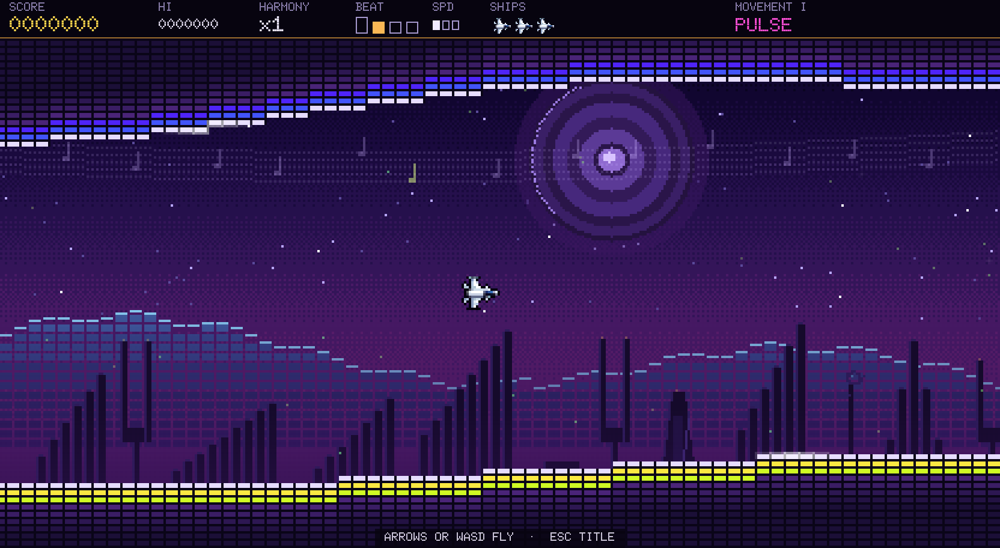

<div align="center">

# Overtone

**A shooter that keeps time.**

A side-scrolling shooter through a neon cosmos where everything moves to the beat. It runs in the browser with a keyboard, mouse or controller.

### [▶ Play it now](https://leeeeeroyj.github.io/overtone/)

[](https://github.com/leeeeeroyj/overtone/actions/workflows/deploy.yml)


[](LICENSE)



</div>

## About

Overtone is an original arcade game inspired by the mechanics of Irem's 1987 arcade game *R-Type*. The game is being built in the open; this is how it plays today.

- **Movement I, Pulse.** A dusk over a city of instruments at 128 beats a minute. A speaker-cone moon ripples on every kick, spectrum-analyser mountains bounce with the music, and the city's lights play in turn through each bar.
- **A frame that keeps time.** The floor and ceiling are walls of LED cells that jump on every beat, with a pulse of light running along both edges. They're solid: touch one and it bounces you off.
- **Direct flight.** Eight directions, no drift. The craft banks as it climbs and dives.
- **Drawn in code.** Every layer of the landscape is pixel art generated when the game loads; nothing is a background image.

## How to play

Fly through Movement I and keep off the walls. Touching the floor or the ceiling bounces you back and makes you blink for a moment. The beat lamp in the top bar shows where you are in the bar: the current beat is filled, and the first beat of the bar is the tall one.

## Controls

| | Keyboard + mouse | Controller |
| --- | --- | --- |
| Fly | Arrows or W A S D | Left stick or D-pad |
| Start | Enter or Space, or click **START** | A or Start |
| Back to the title | Esc | Back |

Controllers show up once you press a button.

## Run it locally

You need [Node.js](https://nodejs.org/) 20.19+ or 22.12+.

```bash
npm install
npm run dev        # http://localhost:5173
npm run build      # type-check and build to dist/
```

Every push to `main` builds the game and deploys it to GitHub Pages.

## Project layout

```
src/
  main.ts            game setup and fonts
  config.ts          tunables: sizes, tempo, scroll speed, flight, colours
  beat.ts            the beat clock everything keeps time to
  terrain.ts         the floor and ceiling, as functions of distance
  land/bake.ts       sky and instrument city, baked once as pixel art
  land/Landscape.ts  every layer, drawn each frame in time with the beat
  controls.ts        keyboard, mouse and gamepad input
  text.ts            crisp text in the game's fonts
  hi.ts              the high score, kept in localStorage
  attract.ts         the ?attract demo mode's settings
  scenes/            title screen, the stage and the HUD
assets/sprites/      the game's 16 × 16 sprites
assets/fonts/        Doto and Monoton, with their licences
design/              concept sheet and build plan
tools/sprites.py     sprite search and export script
tools/cdp.mjs        shared headless Chrome harness for the tests
tools/m*-test.mjs    headless Chrome checks
```

## Credits

- **Sprites:** from the CC0 [Angais/pixel-art-atlas-1.4m](https://huggingface.co/datasets/Angais/pixel-art-atlas-1.4m) collection of AI-generated pixel art, found with [Pixel Search](https://huggingface.co/spaces/cfahlgren1/pixel-search).
- **Fonts:** [Monoton](https://fonts.google.com/specimen/Monoton) by Vernon Adams and [Doto](https://fonts.google.com/specimen/Doto) by the Doto Project Authors (both SIL Open Font License).
- **Engine:** [Phaser](https://phaser.io/).
- **Inspiration:** Irem's *R-Type*. Overtone is an original game and isn't affiliated with or endorsed by the original's rights holders.

## License

The code is released under the [MIT License](LICENSE). The sprites in `assets/sprites/` and `design/` are CC0 (public domain), and the fonts in `assets/fonts/` are under the SIL Open Font License.
